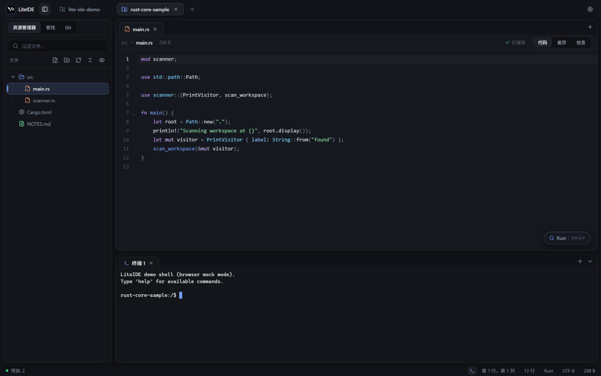

# LiteIDE

[简体中文](README.md) | **English**

A lightweight, cross-platform desktop IDE built with **Tauri v2 (Rust) + SolidJS + Tailwind CSS v4**.

<p align="center">
  
</p>

## Why LiteIDE?

In day-to-day development, most of the time you just want to quickly open a few repositories side by side, browse code, tweak configs, preview Markdown or spreadsheets, run a quick terminal command, or commit via Git.

Firing up a traditional heavyweight IDE (hundreds of MBs to install, gigabytes of RAM, and sluggish cold starts) feels overkill—while a bare plain-text editor lacks a project tree, multi-project tabs, Git integration, and an embedded terminal.

That's why **LiteIDE** exists: instead of trying to do everything, it packages the most frequently used workbench features as on-demand lightweight plugins—keeping **binary size small, memory footprint low, and startup fast**.

## Why It's Light and Fast

### 1. Minimal Footprint
Built on **Tauri v2 + Rust**, LiteIDE reuses the OS native WebView (Windows WebView2 / macOS WKWebView / Linux WebKitGTK) rather than bundling Chromium and a Node.js runtime:

| Release Artifact (Windows x64) | Measured Size |
| --- | --- |
| Installer (`LiteIDE_0.1.0_x64-setup.exe`) | **4.27 MB** |
| Installer (`LiteIDE_0.1.0_x64_en-US.msi`) | **5.91 MB** |
| Standalone Binary (`lite-ide.exe`) | **15.52 MB** |

### 2. Disciplined Memory Usage
- **SolidJS Fine-Grained Reactivity**: Zero Virtual DOM diffing overhead for a lean runtime.
- **Virtual Scrolling & Lazy Loading**: The file tree uses `@tanstack/solid-virtual` for viewport-only rendering and lazy directory expansion. Heavyweight capabilities (like `.xlsx` spreadsheet parsing) are loaded lazily via `liteide.loadChunk`—zero memory used until opened.
- **Bounded Multi-Project Keep-Alive**: Each top tab maps to an isolated `ProjectScope`, with inactive warm projects kept alive up to an LRU cap (default: 5) for instant switching without unbounded memory growth.

### 3. Fast Startup & Responsiveness
- **Rust Native Backend**: `.gitignore`-aware directory listing, `notify` debounced file watching, custom protocol file streaming, and `portable-pty` terminal sessions all run natively in Rust without blocking the UI thread.
- **Micro-Kernel + Lightweight Symbol Index**: A regex-based heuristic symbol index powers `F12` Go to Definition, `Shift+F12` Find References, and `Ctrl+F12` Go to Implementation—handling everyday code navigation without spinning up heavy language server processes.

<p align="center">
  
</p>

## Core Capabilities (Plugin-First)

LiteIDE uses a **micro-kernel + plugin** architecture. All 12 built-in features are compiled and loaded in the standard external `bundle` plugin format—meaning they can be enabled/disabled on demand, and external directory plugins can be installed alongside them:

- **Workspace & Editing**: Isolated multi-project tabs, virtualized file explorer, workspace-wide text search, and CodeMirror 6 editing (full language highlighting + symbol navigation).
- **Multi-Modal File Previews**: Rich Markdown (`markdown-it` + `DOMPurify`), Image/SVG (zoom & pan), Audio waveform playback, Git Diff, Excel (`.xlsx` lazy-loaded), and a fallback binary metadata card.
- **Git & Terminal**: Sidebar Git panel (branches, stage/commit, AI commit message generation, Stash) + bottom `xterm.js` integrated terminal.
- **Themes & i18n**: Built-in Default Dark, Nord, Gruvbox, and Catppuccin Latte themes, with live `zh-CN` / `en-US` language switching.
- **Dual Runtime Modes**: Uses Tauri IPC on desktop, and automatically falls back to a built-in Mock backend with preloaded sample projects when running `pnpm dev` in a browser—ideal for rapid UI preview and debugging without compiling Rust.

## Project Structure

Dependencies flow strictly in one direction: `protocol` → `kernel` → `workbench` → `plugins/*` → `apps/desktop`.

```text
lite-ide/
├── apps/desktop/       # @lite-ide/desktop — Vite + SolidJS entry & global styles
├── packages/
│   ├── protocol/       # WorkspaceBackend contract (Tauri IPC / Browser Mock)
│   ├── kernel/         # Micro-kernel, ProjectScope, ServiceKey DI, EventBus
│   ├── plugin-sdk/     # External plugin SDK & type definitions
│   └── workbench/      # Workbench shell, symbol index, code navigation & plugin registry
├── plugins/            # 12 built-in plugins (explorer, search, git, terminal, preview-*, theme-*)
├── samples/plugins/    # External plugin examples (classic & bundle formats)
├── src-tauri/          # Rust native backend (safe path resolution, watcher, PTY, plugin manager)
└── docs/screenshots/   # README screenshots
```

## Quick Start

### Prerequisites

- **Node.js** >= 20 & **pnpm** >= 9
- **Rust** toolchain (only required when running or bundling the Tauri desktop app; browser Mock mode does not require Rust)

### Install & Run

```bash
# Install dependencies
pnpm install

# Browser Mock mode (builds plugins and starts at http://localhost:1420)
pnpm dev

# Tauri desktop dev mode
pnpm tauri:dev

# Build desktop installers
pnpm tauri:build
```

### Common Development & Verification Commands

```bash
pnpm build:plugins   # Build all built-in and sample plugin dists in parallel
pnpm watch:plugins   # Watch plugin sources and rebuild dists on change
pnpm typecheck       # Run TypeScript typechecking across all packages
pnpm test            # Run Vitest unit tests
pnpm test:e2e        # Run Playwright E2E tests
cargo test --manifest-path src-tauri/Cargo.toml  # Run Rust backend tests
```
