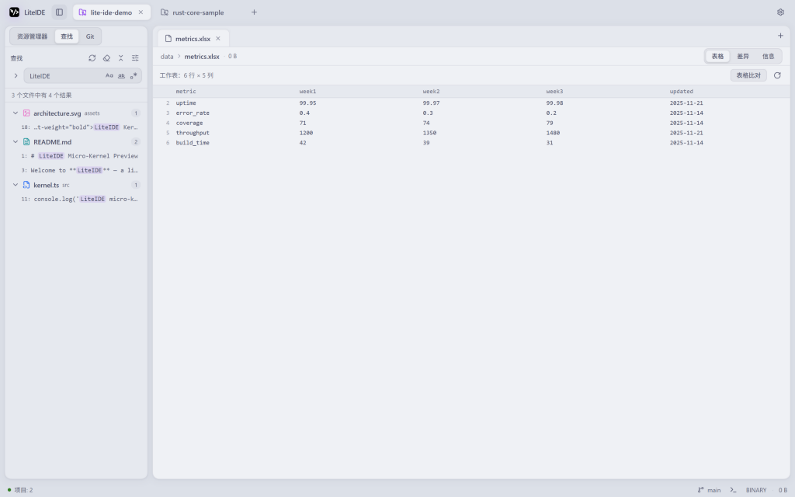
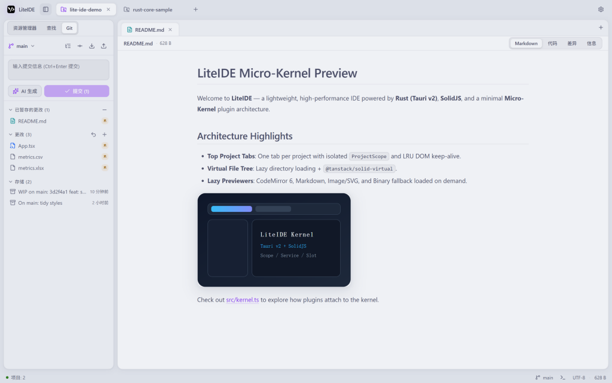

# LiteIDE

[简体中文](README.md) | **English**

A lightweight, cross-platform desktop IDE built with **Tauri v2 (Rust) + SolidJS + Tailwind CSS v4**.

<p align="center">
  
</p>

## Why LiteIDE?

In day-to-day development, most of the time you just want to quickly open a few repositories side by side, browse code, tweak configs, preview Markdown or spreadsheets, run a quick terminal command, or commit via Git.

Firing up a traditional heavyweight IDE (hundreds of MBs to install, gigabytes of RAM, and sluggish cold starts) feels overkill—while a bare plain-text editor lacks a project tree, multi-project tabs, Git integration, and an embedded terminal.

That's why **LiteIDE** exists: instead of trying to do everything, it packages the most frequently used workbench features as on-demand lightweight plugins—keeping **binary size small, memory footprint low, and startup fast**.

## Why It's Light and Fast

### 1. Minimal Footprint
Built on **Tauri v2 + Rust**, LiteIDE reuses the OS native WebView (Windows WebView2 / macOS WKWebView / Linux WebKitGTK) rather than bundling Chromium and a Node.js runtime:

| Release Artifact (Windows x64) | Measured Size |
| --- | --- |
| Installer (`LiteIDE_0.1.0_x64-setup.exe`) | **4.27 MB** |
| Installer (`LiteIDE_0.1.0_x64_en-US.msi`) | **5.91 MB** |
| Portable (`LiteIDE_0.1.0_x64-portable.zip`) | **5.83 MB** |
| Standalone Binary (`lite-ide.exe`) | **15.52 MB** |

### 2. Disciplined Memory Usage
- **SolidJS Fine-Grained Reactivity**: Zero Virtual DOM diffing overhead for a lean runtime.
- **Virtual Scrolling & Lazy Loading**: The file tree uses `@tanstack/solid-virtual` for viewport-only rendering and lazy directory expansion. Heavyweight capabilities (like `.xlsx` spreadsheet parsing) are loaded lazily via `liteide.loadChunk`—zero memory used until opened.
- **Bounded Multi-Project Keep-Alive**: Each top tab maps to an isolated `ProjectScope`, with inactive warm projects kept alive up to an LRU cap (default: 5) for instant switching without unbounded memory growth.

### 3. Fast Startup & Responsiveness
- **Rust Native Backend**: `.gitignore`-aware directory listing, `notify` debounced file watching, custom protocol file streaming, and `portable-pty` terminal sessions all run natively in Rust without blocking the UI thread.
- **Micro-Kernel + Lightweight Symbol Index**: A regex-based heuristic symbol index powers `F12` Go to Definition, `Shift+F12` Find References, and `Ctrl+F12` Go to Implementation—handling everyday code navigation without spinning up heavy language server processes.

---

## Features & Showcase

### 1. Git Integration & Side-by-Side Diff
- **Complete Daily Workflow**: Branch switching, Git worktree switching and merging, stage/unstage/discard changes, and Stash management.
- **Dual Diff Modes**: Supports both **Unified** and **Side-by-Side (Split)** diff views with crisp red/green line highlights and quick switching between working tree and staged changes.
- **AI Commit Message Generation**: Optional model integration to generate commit messages in one click (with `Ctrl+Enter` to commit).

<p align="center">
  
</p>

### 2. Global Search & Multi-Modal Previews
- **Workspace-Wide Search**: Fast text search across projects with case-sensitive, whole-word, regex toggles, and custom exclude rules—click any match to jump directly to the highlighted line.
- **Built-In Multi-Format Previews**: Inspect common assets directly without external apps:
  - **Excel Spreadsheets (`.xlsx`)**: Lazy-loaded parser renders sheets, dimensions, and rows directly, with built-in **table diffing**;
  - **Rich Markdown**: Safe rendering via `markdown-it` + `DOMPurify`, supporting relative images, SVG diagrams, and clickable workspace file links;
  - **Images / SVG**: Checkerboard transparency background, zoom, and pan;
  - **Audio Files**: Built-in waveform visualization and playback controls;
  - **Binary Fallback Card**: Displays size, encoding, and metadata for arbitrary binary files without freezing the editor.

<table>
  <tr>
    <td width="50%">
      
      <p align="center"><sub>Workspace Search + Instant <code>.xlsx</code> Spreadsheet Preview</sub></p>
    </td>
    <td width="50%">
      
      <p align="center"><sub>Catppuccin Latte Theme + Rich Markdown & SVG Preview</sub></p>
    </td>
  </tr>
</table>

### 3. Multi-Project Workbench, Code Editing & Terminal
- **Isolated Multi-Project Tabs**: Open multiple repositories simultaneously—each project keeps its own file tree, search state, Git status, open file tabs, and terminal sessions.
- **CodeMirror 6 Editing**: Full-language syntax highlighting, in-file Find & Replace (`Ctrl+F`), `F12` Go to Definition / `Shift+F12` References / `Ctrl+F12` Implementations (plus `Ctrl+Click` navigation), and status bar line/column/encoding stats.
- **Multi-Tab Integrated Terminal**: Powered by `xterm.js` + `portable-pty`, toggled via `Ctrl+\`` with background session keep-alive so running commands never lose output when hidden.

### 4. Plugin-First Architecture, Themes & Dual Modes
- **12 Built-In Plugins**: Explorer, Search, Git, Terminal, 4 theme plugins, and 5 previewers are all compiled as standard `bundle` plugins—toggle them anytime in Settings or install external plugins from a local folder.
- **Themes & i18n**: Ships with Default Dark, Nord, Gruvbox, and Catppuccin Latte, plus live `zh-CN` / `en-US` language switching.
- **Desktop + Browser Dual Mode**: Runs over Tauri IPC on desktop, and automatically falls back to a built-in Mock backend with a pseudo-shell and sample projects on `pnpm dev`—great for quick previews and UI development without compiling Rust.

---

## Project Structure

Dependencies flow strictly in one direction: `protocol` → `kernel` → `workbench` → `plugins/*` → `apps/desktop`.

```text
lite-ide/
├── apps/desktop/       # @lite-ide/desktop — Vite + SolidJS entry & global styles
├── packages/
│   ├── protocol/       # WorkspaceBackend contract (Tauri IPC / Browser Mock)
│   ├── kernel/         # Micro-kernel, ProjectScope, ServiceKey DI, EventBus
│   ├── plugin-sdk/     # External plugin SDK & type definitions
│   └── workbench/      # Workbench shell, symbol index, code navigation & plugin registry
├── plugins/            # 12 built-in plugins (explorer, search, git, terminal, preview-*, theme-*)
├── samples/plugins/    # External plugin examples (classic & bundle formats)
├── src-tauri/          # Rust native backend (safe path resolution, watcher, PTY, plugin manager)
└── docs/screenshots/   # README screenshots
```

## Quick Start

### Prerequisites

- **Node.js** >= 20 & **pnpm** >= 9
- **Rust** toolchain (only required when running or bundling the Tauri desktop app; browser Mock mode does not require Rust)

### Install & Run

```bash
# Install dependencies
pnpm install

# Browser Mock mode (builds plugins and starts at http://localhost:1420)
pnpm dev

# Tauri desktop dev mode
pnpm tauri:dev

# Build desktop installers
pnpm tauri:build
```

### Common Development & Verification Commands

```bash
pnpm build:plugins   # Build all built-in and sample plugin dists in parallel
pnpm watch:plugins   # Watch plugin sources and rebuild dists on change
pnpm typecheck       # Run TypeScript typechecking across all packages
pnpm test            # Run Vitest unit tests
pnpm test:e2e        # Run Playwright E2E tests
cargo test --manifest-path src-tauri/Cargo.toml  # Run Rust backend tests
```
