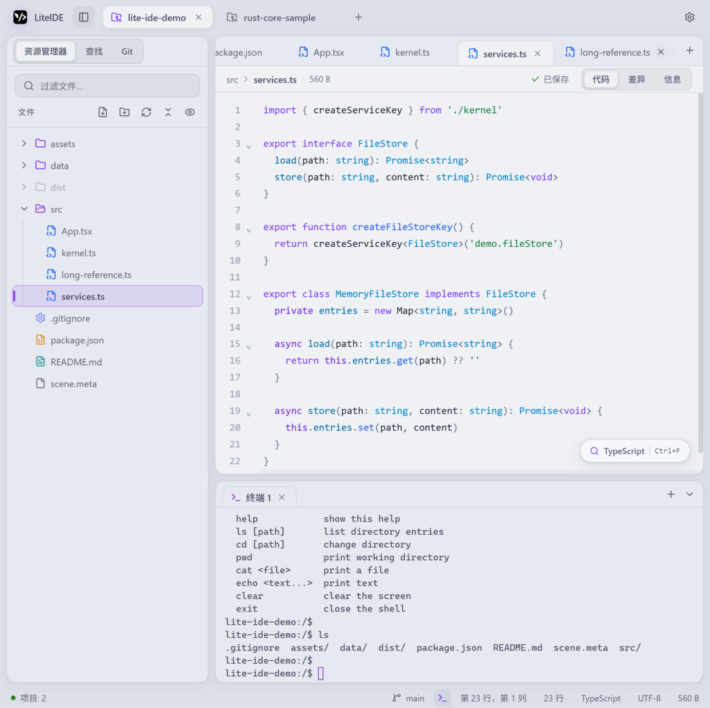
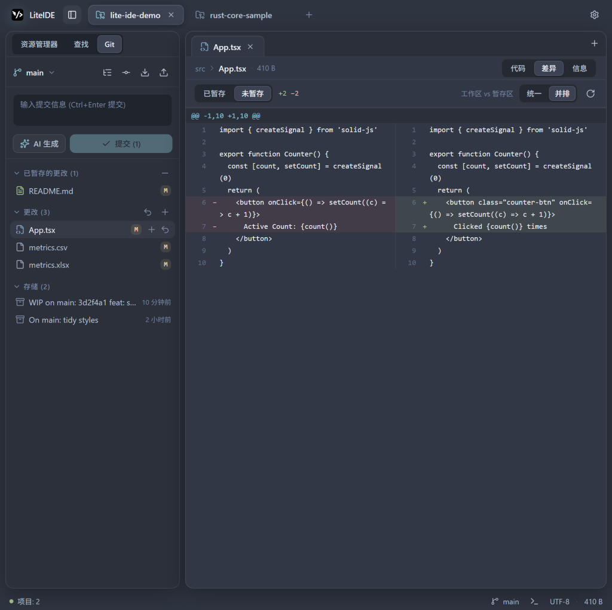
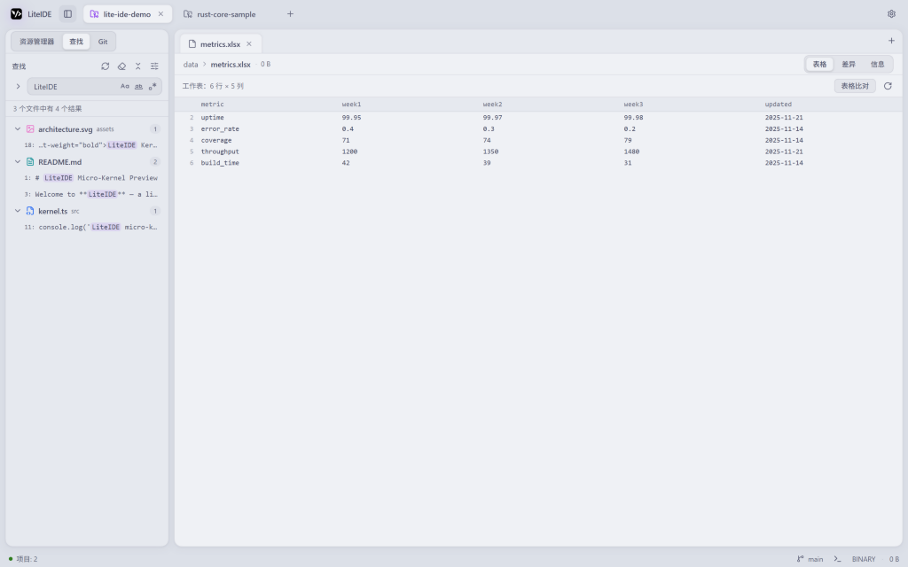
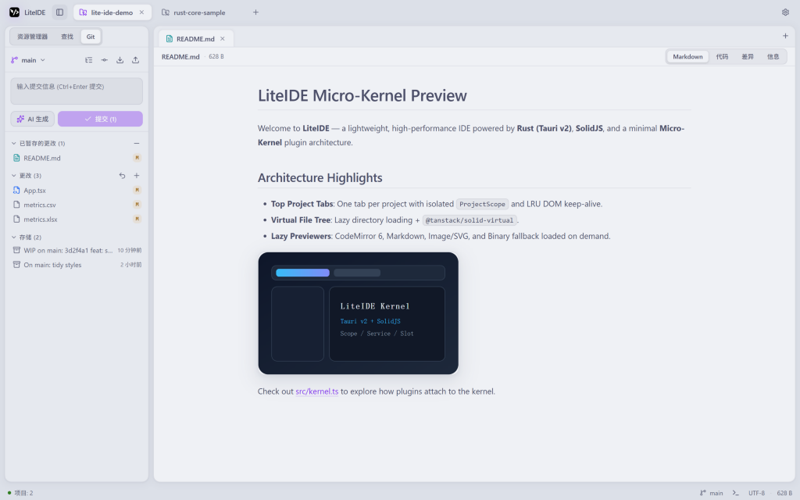

# LiteIDE

**简体中文** | [English](README.en.md)

轻量级跨平台桌面 IDE，基于 **Tauri v2 (Rust) + SolidJS + Tailwind CSS v4** 构建。

<p align="center">
  
</p>

## 为什么做这个项目

日常开发里，很多时候只是想快速打开几个仓库对照看看代码、改几行配置、预览下 Markdown 或表格文件，顺手跑个终端命令、提交下 Git。

打开传统重型 IDE（动辄几百 MB 安装包、常驻上 GB 内存、冷启动要等半天）实在太重；而用纯文本编辑器又少了工程目录、多项目切换、Git 和终端这些顺手的工具。

所以做了 **LiteIDE**：不追求大而全，只把最常用的工作台能力做成可按需加载的轻量插件，尽量做到**体积小、内存省、打开就能用**。

## 为什么它足够轻、足够快？

### 1. 极致小巧的应用体积
基于 **Tauri v2 + Rust**，直接复用系统原生 WebView（Windows WebView2 / macOS WKWebView / Linux WebKitGTK），彻底省去捆绑 Chromium 和 Node.js 运行时的冗余体积：

| 构建产物（Windows x64 Release） | 实测大小 |
| --- | --- |
| 安装包 (`LiteIDE_0.1.0_x64-setup.exe`) | **4.27 MB** |
| 安装包 (`LiteIDE_0.1.0_x64_en-US.msi`) | **5.91 MB** |
| 便携版 (`LiteIDE_0.1.0_x64-portable.zip`) | **5.83 MB** |
| 主程序单文件 (`lite-ide.exe`) | **15.52 MB** |

### 2. 克制的内存占用
- **SolidJS 细粒度响应式**：无 Virtual DOM diff 开销，运行时极其轻盈；
- **虚拟滚动与懒加载**：文件树基于 `@tanstack/solid-virtual` 按视口渲染、目录按需展开；大型能力（如 `.xlsx` 表格解析）通过 `liteide.loadChunk` 懒加载，不触发不加载、不占内存；
- **受控的多项目保活**：顶部一个标签页对应一个独立的 `ProjectScope`，非活跃热项目按 LRU 上限（默认 5 个）保活，切项目秒回现场的同时防止内存无限膨胀。

### 3. 快速启动与响应
- **Rust 原生后端**：文件列举（遵循 `.gitignore`）、`notify` 防抖监听、自定义协议文件流传输与 `portable-pty` 终端均由 Rust 原生承载，冷启动即开即用，不卡界面主线程；
- **微内核 + 轻量化符号索引**：用轻量正则启发式符号索引提供 `F12` 跳转定义 / `Shift+F12` 查看引用 / `Ctrl+F12` 转到实现，无需拉起沉重的语言服务器进程即可完成日常代码浏览。

---

## 核心功能与界面展示

### 1. Git 集成与并排差异对比
- **完整日常工作流**：支持分支切换、Git Worktree 切换与合并、文件暂存/取消暂存/丢弃更改、Stash 存储管理。
- **双模式 Diff 对比**：支持**统一（Unified）**与**并排（Split）**视图，清晰高亮增删行；支持工作区与暂存区差异快速切换。
- **AI 提交信息生成**：支持接入模型配置一键生成 Commit Message（支持 `Ctrl+Enter` 快捷提交）。

<p align="center">
  
</p>

### 2. 全局查找与多模态文件预览
- **全局文本查找**：支持跨工作区快速检索，提供区分大小写、全词匹配、正则表达式以及自定义目录排除规则，点击结果直接跳转并高亮对应代码行。
- **开箱即用的多格式预览**：无需额外安装插件或本地办公软件，原生支持多种文件格式：
  - **Excel 表格（`.xlsx`）**：按需懒加载解析，直接渲染行列数据与结构信息，并支持**表格比对**差异；
  - **Markdown 富文本**：基于 `markdown-it` + `DOMPurify` 安全渲染，支持相对路径图片、SVG 图表与站内代码文件一键跳转；
  - **图片 / SVG**：棋盘格透明背景、滚轮缩放与拖拽平移；
  - **音频文件**：内置波形渲染与播放控制；
  - **兜底元信息卡**：任意未知或二进制文件自动展示大小、编码与基础元信息，不会卡死编辑器。

<table>
  <tr>
    <td width="50%">
      
      <p align="center"><sub>全局正则查找 + <code>.xlsx</code> 表格即时预览</sub></p>
    </td>
    <td width="50%">
      
      <p align="center"><sub>Catppuccin 浅色主题 + Markdown 富文本与 SVG 渲染</sub></p>
    </td>
  </tr>
</table>

### 3. 多项目工作区、代码编辑与集成终端
- **多项目隔离标签页**：同时打开多个仓库时，每个项目拥有独立的文件树、搜索历史、Git 状态、打开文件标签与终端会话，切换互不干扰。
- **CodeMirror 6 代码编辑**：支持主流编程语言语法高亮、页内查找替换（`Ctrl+F`）、`F12` 跳转定义 / `Shift+F12` 查看引用 / `Ctrl+F12` 转到实现（支持 `Ctrl+点击` 跳转）以及状态栏编码/行列统计。
- **多标签集成终端**：底部集成 `xterm.js` + `portable-pty` 原生终端，支持 `Ctrl+\`` 一键呼出或折叠，隐藏时保活运行中的命令输出。

### 4. 全插件化架构、多主题与双模式运行
- **12 个内置插件按需启停**：Explorer、Search、Git、Terminal、4 个主题插件、5 个预览器均采用标准 `bundle` 格式加载，可在设置中自由启用或停用，也支持从本地文件夹安装第三方插件。
- **多主题与多语言**：内置 Default Dark、Nord、Gruvbox、Catppuccin Latte 多套配色，支持跟随系统与 `zh-CN` / `en-US` 实时切换。
- **桌面端 + 浏览器双模式**：桌面端通过 Tauri IPC 调用原生能力；浏览器运行 `pnpm dev` 自动启用内置 Mock 后端与伪终端并预载示例项目，无需编译 Rust 即可快速体验或调试界面。

---

## 目录结构

依赖严格单向流动：`protocol` → `kernel` → `workbench` → `plugins/*` → `apps/desktop`。

```text
lite-ide/
├── apps/desktop/       # @lite-ide/desktop — Vite + SolidJS 入口与全局样式
├── packages/
│   ├── protocol/       # WorkspaceBackend 契约（Tauri IPC / 浏览器 Mock）
│   ├── kernel/         # 微内核、ProjectScope、ServiceKey DI、EventBus
│   ├── plugin-sdk/     # 外部插件开发 SDK 与类型定义
│   └── workbench/      # 工作台壳层、符号索引、代码导航与插件注册表
├── plugins/            # 12 个内置插件（explorer, search, git, terminal, preview-*, theme-*）
├── samples/plugins/    # 外部插件开发样例（classic & bundle 格式）
├── src-tauri/          # Rust 原生后端（文件安全校验、监听、PTY、插件管理）
└── docs/screenshots/   # README 展示截图
```

## 快速开始

### 环境要求

- **Node.js** >= 20 & **pnpm** >= 9
- **Rust** 工具链（仅运行或打包 Tauri 桌面端时需要；浏览器 Mock 模式无需安装 Rust）

### 安装与运行

```bash
# 安装依赖
pnpm install

# 浏览器 Mock 模式（自动构建插件并在 http://localhost:1420 启动）
pnpm dev

# Tauri 桌面端开发模式
pnpm tauri:dev

# 打包桌面端安装包
pnpm tauri:build
```

### 常用开发与校验命令

```bash
pnpm build:plugins   # 并行构建全部内置与样例插件 dist
pnpm watch:plugins   # 监听插件源码变化并自动重编
pnpm typecheck       # 全量 TypeScript 类型检查
pnpm test            # Vitest 单元测试
pnpm test:e2e        # Playwright E2E 测试
cargo test --manifest-path src-tauri/Cargo.toml  # Rust 后端测试
```
